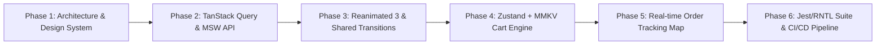

# CoffeeApp — Architecture & Engineering Roadmap
### Elevating from a Prototype to a Mid-to-Senior Grade React Native Showcase

---

## 🎯 Executive Vision & Recruiter Evaluation Criteria

When engineering leads and senior React Native recruiters review portfolio code, they look past basic screens and look for **production engineering discipline**. 

| What Amateurs / Junior Templates Do | What Mid / Senior Production Code Does |
| :--- | :--- |
| Hardcoded component state and inline styles (`marginTop: '-18%'`, `height / 4.2`) | Centralized Design System with design tokens, responsive typography scales, and safe-area math |
| Massive, monolithic screen components with 300+ lines mixing UI, fetch calls, and math | Modular, Feature-Sliced architecture with isolated UI, domain business logic, and custom hooks |
| Hardcoded arrays or unhandled `fetch` promises without retry, cache, or error boundaries | Robust data layer using **TanStack Query** + **MSW** (Mock Service Worker) with caching & optimistic updates |
| No state persistence; state resets on app reload | High-performance native persistence with **Zustand** + **react-native-mmkv** |
| Choppy JavaScript-thread animations or static touchables | 60–120 FPS UI-thread animations via **Reanimated 3**, **Shared Element Transitions**, and **Gesture Handler** |
| Zero automated tests, loose types with `any`, and default folder structures | Complete **Jest + React Native Testing Library** suite, strict TypeScript, and GitHub Actions CI |

---

## 🏗️ Target Architectural Blueprint

The application will migrate to a **Feature-First / Domain-Driven Architecture**:

```
CoffeeApp/
├── .github/
│   └── workflows/
│       └── ci.yml                     # Automated Lint, TypeScript check, and Jest test runner
├── src/
│   ├── app/                           # App setup & providers
│   │   ├── App.tsx                    # Root provider composition (QueryClient, Theme, Navigation)
│   │   ├── AppNavigator.tsx           # Typed Stack & Tab navigation root
│   │   └── providers/                 # BottomSheetModalProvider, GestureHandlerRootView, etc.
│   │
│   ├── assets/                        # Fixed typo from 'assests'
│   │   ├── fonts/                     # Sora font families
│   │   ├── images/                    # Hero banners, coffee photography
│   │   └── icons/                     # Vector icons & custom SVG glyphs
│   │
│   ├── features/                      # Domain-specific modules (Feature-Sliced)
│   │   ├── catalog/                   # Product discovery & home feed
│   │   │   ├── api/                   # useCoffeeQuery, coffeeService
│   │   │   ├── components/            # CoffeeCard, CategoryChips, PromoCarousel, SearchHeader
│   │   │   ├── hooks/                 # useCoffeeFilter, useDebouncedSearch
│   │   │   └── screens/HomeScreen.tsx
│   │   │
│   │   ├── details/                   # Coffee customization & details
│   │   │   ├── components/            # SizeSelector, MilkOptionPicker, ExpandableText
│   │   │   ├── hooks/                 # useCustomizationPricing
│   │   │   └── screens/DetailsScreen.tsx
│   │   │
│   │   ├── cart/                      # Shopping cart, checkout & pricing
│   │   │   ├── store/                 # useCartStore (Zustand + MMKV)
│   │   │   ├── components/            # CartItemRow, OrderSummaryCard, DeliveryTypeToggle
│   │   │   └── screens/CartScreen.tsx (Explore tab replacement)
│   │   │
│   │   ├── order/                     # Live order tracking & active orders
│   │   │   ├── components/            # OrderTrackingMap, StatusTimeline, DriverContactBar
│   │   │   ├── hooks/                 # useLiveOrderStatus (WebSocket/Interval mock)
│   │   │   └── screens/OrderTrackingScreen.tsx
│   │   │
│   │   └── favorites/                 # Wishlist & saved items
│   │       ├── store/                 # useFavoritesStore
│   │       └── screens/FavoritesScreen.tsx
│   │
│   ├── shared/                        # Cross-cutting reusable primitives
│   │   ├── components/                # Button, Badge, Skeleton, IconButton, BottomSheetContainer
│   │   ├── hooks/                     # useHaptics, useResponsiveScale, useNetworkStatus
│   │   ├── theme/                     # Colors, Spacing, Typography, Shadows, ThemeProvider
│   │   └── utils/                     # Formatters (currency, address), storage helpers
│   │
│   └── mocks/                         # Mock Service Worker & offline fixtures
│       ├── data/                      # Fixture data with detailed ingredients & descriptions
│       └── server.ts                  # Simulated REST API endpoints with latency & error rates
```

---

## 🗺️ Phased Implementation Challenges

Each phase below is structured as an **engineering challenge** designed to teach you industry-standard patterns and generate bullet points for your resume.

---

### Phase 1: Foundational Architecture & The Design System
> **Goal:** Eliminate technical debt, structure TypeScript path aliases, and build a reusable design token engine.

#### 1. Challenges to Tackle:
- **Clean Folder Clean-up**: Rename `src/assests` &rarr; `src/assets`, configure `tsconfig.json` paths for `@features/*`, `@shared/*`, `@theme/*`, `@assets/*`.
- **Design Tokens System**: Build a strongly-typed theme object containing:
  - **Color Palette**: Warm espresso (`#C67C4E`), dark roast (`#161616`), froth white (`#FFFFFF`), muted gray (`#9B9B9B`), error red (`#ED5151`).
  - **Typography Scale**: Clean mapping for custom `Sora` fonts (`Sora-Regular`, `Sora-SemiBold`, `Sora-Bold`) with explicit line heights and letter spacings.
  - **Spacing Tokens**: Base 4/8-point grid (`xs: 4`, `sm: 8`, `md: 16`, `lg: 24`, `xl: 32`).
- **Responsive Layout Utility**: Replace brittle percentage division (`height / 4.2`) with modern `useWindowDimensions()` scaling helpers (`moderateScale`, `verticalScale`) or safe flexbox constraints.
- **Global Error Boundary**: Implement an `ErrorBoundary` component that catches JavaScript crashes gracefully and renders a fallback recovery screen.

#### 🛠️ Tech & Libraries:
`typescript`, `react-native-safe-area-context`, custom Design System.

---

### Phase 2: High-Performance Data Layer & Catalog Redesign
> **Goal:** Replace hardcoded lists with a realistic asynchronous API, simulated latency, caching, and scroll performance.

#### 1. Challenges to Tackle:
- **Mock REST API with Simulated Network**:
  - Implement a mock service layer using `msw` (Mock Service Worker) or an async service simulator.
  - Support endpoints: `GET /coffees?category=...&search=...`, `GET /coffees/:id`, `POST /orders`.
  - Add configurable artificial latency (400ms–800ms) and random 5% network failures to demonstrate resilience.
- **TanStack Query (React Query v5) Integration**:
  - Implement `useCoffeeQuery` and `useCoffeeByIdQuery`.
  - Cache results, handle `isLoading`, `isError`, and `isRefetching` states.
  - Implement Pull-to-Refresh with seamless cache invalidation.
- **Debounced Search & Category Filtering**:
  - Create a custom hook `useDebouncedSearch` (300ms debounce) so the search input doesn't trigger jittery re-renders.
  - Filter by category with animated indicator feedback.
- **Shimmer Skeletons**:
  - Replace `<ActivityIndicator>` with custom animated Shimmer Skeleton cards while the coffee feed loads.
- **Scroll Optimization**:
  - Convert `FlatList` to use optimized props (`getItemLayout`, `initialNumToRender={6}`, `windowSize={5}`, `removeClippedSubviews={true}`) or evaluate Shopify's `FlashList`.

#### 🛠️ Tech & Libraries:
`@tanstack/react-query`, `msw`, `@shopify/flash-list` (or optimized `FlatList`).

---

### Phase 3: Fluid Animations & Shared Element Transitions
> **Goal:** Deliver a 60–120 FPS native experience running worklets on the UI thread that immediately impresses any reviewer.

#### 1. Challenges to Tackle:
- **Shared Element Transition (CoffeeCard &rarr; DetailsScreen)**:
  - Seamlessly morph the coffee cup image from the grid card into the hero header on `DetailsScreen` using `react-native-reanimated` Shared Transitions.
- **Sticky Animated Header**:
  - Drive header opacity, elevation, and search collapse based on vertical scroll offset using `useAnimatedScrollHandler` and `useAnimatedStyle`.
- **Interactive Cup Size Selector**:
  - Implement an animated pill slider for cup sizes (**S**, **M**, **L**) where the selection pill smoothly springs into place using `withSpring()`.
- **Haptic Feedback**:
  - Add sensory physical ticks (`react-native-haptic-feedback`) when selecting sizes, tapping favorites, and adding to the cart.
- **Expandable Description Animation**:
  - Smooth height transition when expanding "Read More" on coffee origin descriptions.

#### 🛠️ Tech & Libraries:
`react-native-reanimated` (v3), `react-native-gesture-handler`, `react-native-haptic-feedback`.

---

### Phase 4: State Management & The Cart Engine
> **Goal:** Implement persistent global state with atomic updates, business logic calculations, and bottom-sheet micro-interactions.

#### 1. Challenges to Tackle:
- **Zustand + MMKV Persistent Cart**:
  - Implement `useCartStore` with operations: `addItem`, `removeItem`, `updateQuantity`, `clearCart`.
  - Persist store data into `react-native-mmkv` (up to 30x faster than `AsyncStorage`).
  - Compute reactive derived state: `totalItemCount`, `subtotal`, `deliveryFee`, `tax`, `discountAmount`, `grandTotal`.
- **Interactive Customization Bottom Sheet**:
  - Use `@gorhom/bottom-sheet` on the Details screen or Quick Add button:
    - Select milk type (Oat, Almond, Whole, Skim).
    - Select sweetness level (0%, 50%, 100%).
    - Toggle extra espresso shot (+ \$1.00).
- **Cart Screen Interaction**:
  - Swipe-to-delete item gesture using Reanimated swipeable rows.
  - Promo code input with instant validation and discount animation.
  - Empty cart state with an animated CTA redirecting back to catalog.

#### 🛠️ Tech & Libraries:
`zustand`, `react-native-mmkv`, `@gorhom/bottom-sheet`.

---

### Phase 5: Live Order Tracking & Geolocation Map Experience
> **Goal:** Replace stub tabs with a live, real-time simulated delivery experience.

#### 1. Challenges to Tackle:
- **Order Confirmation & Status Machine**:
  - Model a strict finite state machine for order lifecycle:
    `PLACED` &rarr; `PREPARING (Barista brewing)` &rarr; `ON_THE_WAY (Courier en route)` &rarr; `DELIVERED`.
- **Interactive Tracking Map**:
  - Integrate map rendering showing the user's reverse-geocoded location (via existing Geoapify key or `react-native-maps`).
  - Plot coffee shop origin marker, delivery driver marker, and destination marker with polyline routes.
- **Live Courier Progress Simulation**:
  - Animate courier marker movement along the route coordinates using simulated intervals.
  - Floating bottom card showing estimated time of arrival (ETA), courier name, phone button, and status step progress bar.
- **Favorites & Saved Items Module**:
  - Connect `FavoritesScreen` to `useFavoritesStore` with optimistic toggle animations and empty state.

#### 🛠️ Tech & Libraries:
`react-native-maps` (or Leaflet/MapLibre), `react-native-geolocation-service`, Reanimated progress bar.

---

### Phase 6: Production Engineering, Testing & CI/CD
> **Goal:** Deliver bulletproof code quality that passes strict code reviews.

#### 1. Challenges to Tackle:
- **Unit & Logic Testing (Jest)**:
  - Unit tests for pure business logic: price calculation with modifiers (size, milk, shots), discount algorithms, and formatters.
  - Store tests: Verify `useCartStore` and `useFavoritesStore` state transitions and MMKV hydration.
- **Component & Interaction Testing (React Native Testing Library)**:
  - Test `<CoffeeCard />`: renders data, fires `onPress`, toggles favorite icon.
  - Test `<DetailsScreen />`: size changes reflect in total price button.
  - Test `<CartScreen />`: incrementing quantity updates total price correctly.
- **Automated CI Workflow (.github/workflows/ci.yml)**:
  - GitHub Actions pipeline on push/pull request:
    1. Run TypeScript compiler (`tsc --noEmit`).
    2. Run ESLint & Prettier format check.
    3. Run Jest test runner with coverage threshold.
- **Recruiter Showcase README**:
  - Architecture diagram (Mermaid flow).
  - High-res screen previews and animated GIFs.
  - Technical decisions writeup (Why Zustand over Redux, why MMKV over AsyncStorage, why Reanimated 3 over Animated).

#### 🛠️ Tech & Libraries:
`jest`, `@testing-library/react-native`, `github-actions`.

---

## 📈 Learning Milestones & Resume Impact

Completing this roadmap equips you with exact technical talking points for your interviews:



### Resume Bullet Points You Will Gain:
- *"Architected a high-performance React Native (0.81) e-commerce application using Feature-Sliced Architecture, strict TypeScript, and centralized design tokens."*
- *"Built an offline-first caching layer with TanStack Query v5 and Mock Service Worker (MSW), reducing redundant network requests with optimistic updates and background refetching."*
- *"Implemented 60+ FPS UI-thread animations and shared element transitions leveraging React Native Reanimated 3 and Gesture Handler."*
- *"Engineered a persistent reactive shopping cart utilizing Zustand backed by react-native-mmkv for ultra-low latency native storage."*
- *"Integrated live order tracking with dynamic map markers, route polylines, and real-time step progress state machine."*
- *"Authored comprehensive unit and integration test suites using Jest and React Native Testing Library, enforced via automated GitHub Actions CI pipelines."*
